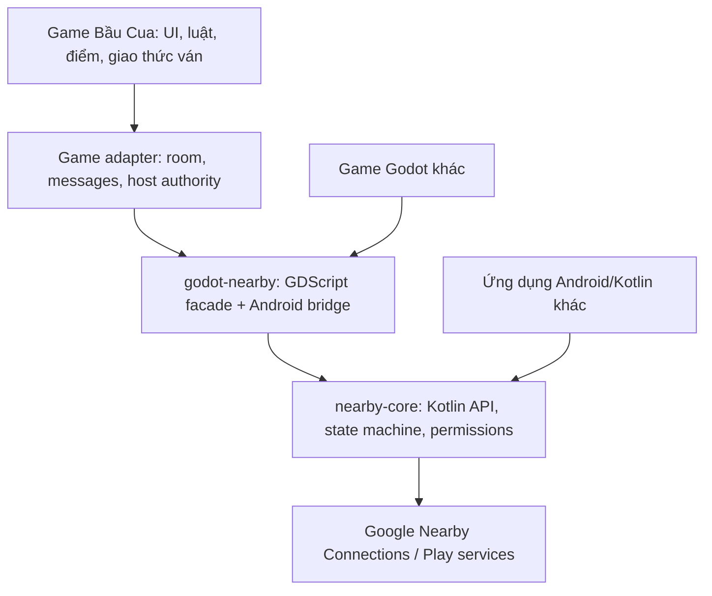

# Kiến trúc plugin Nearby dùng lại

## 1. Ranh giới trách nhiệm



`nearby-core` chỉ biết endpoint, connection và bytes. `godot-nearby` chỉ chuyển kiểu dữ liệu và sự kiện. Game adapter mới biết phòng Bầu Cua, người chơi, lượt, điểm và màn hình. Hướng này cho phép thay game hoặc dùng thư viện trong ứng dụng khác mà không sửa lớp kết nối.

## 2. Cấu trúc gói đề xuất

Tạo kho/thư mục plugin riêng, phát hành theo phiên bản, không đặt mã nguồn plugin bên trong `scripts/ui` của game:

```text
godot-nearby-connections/
├── nearby-core/           # Android library Kotlin, không phụ thuộc Godot
├── godot-bridge/          # Godot Android plugin v2, phụ thuộc nearby-core
├── addons/godot_nearby/   # plugin.cfg, EditorExportPlugin, facade, AAR/dependency
├── demo/                  # dự án Godot độc lập: host/join/echo/4 máy
├── android-demo/          # app Kotlin tối thiểu để thử nearby-core độc lập
├── tests/                 # unit, contract và kịch bản thiết bị thật
└── docs/                  # API, quyền, tích hợp, migration, changelog
```

Phát hành `nearby-core` bằng AAR/Maven và `godot-nearby` bằng thư mục addon/zip gắn phiên bản. Khóa phiên bản Gradle, Google Play services và Godot API; có changelog và chính sách tương thích. Giấy phép mã nguồn và phân phối nội bộ/công khai cần được chọn trước khi xuất bản plugin.

## 3. Hợp đồng API của plugin

Đây là **hợp đồng thiết kế**, tên hàm và kiểu tham số sẽ được xác nhận bằng bản thử hai máy trước khi khóa API 1.0.

| Nhóm | API dự kiến | Kết quả |
| --- | --- | --- |
| Khả dụng | `get_capabilities()`, `get_missing_permissions()` | Nêu rõ Play services, radio, quyền và lý do không dùng được. |
| Quyền | `request_permissions()` | Chỉ gọi sau thao tác chọn “Chơi gần nhau”; trả kết quả qua sự kiện. |
| Khám phá | `start_advertising(service_id, display_name, strategy)`, `start_discovery(service_id, strategy)`, `stop_discovery()` | Host công bố phòng; khách tìm phòng. |
| Kết nối | `request_connection(endpoint_id, display_name)`, `accept_connection(endpoint_id)`, `reject_connection(endpoint_id)` | Hai phía đều chủ động chấp nhận sau khi so mã xác thực. |
| Dữ liệu | `send_bytes(endpoint_id, bytes)`, `send_bytes_to_many(endpoint_ids, bytes)` | Gửi payload `BYTES` có giới hạn kích thước. |
| Vòng đời | `disconnect(endpoint_id)`, `stop_all()`, `get_state()` | Dọn sạch discovery, advertising và các kết nối. |

Sự kiện chuẩn hóa: `endpoint_found`, `endpoint_lost`, `connection_initiated` (gồm tên và mã xác thực), `connection_result`, `payload_received`, `endpoint_disconnected`, `permission_result`, `state_changed`, `error`. Mỗi sự kiện có mã lỗi ổn định và `request_id`/`endpoint_id` liên quan; không để lộ exception hoặc mã lỗi Android không ổn định trực tiếp cho game. Gọi callback vào Godot main thread; quản lý lifecycle Activity để tránh giữ tham chiếu sau khi đóng ứng dụng.

Một instance chỉ vận hành một phiên quảng bá hoặc khám phá. Plugin không tự nhận mọi kết nối, tự tạo phòng, tự lưu dữ liệu hay tự quyết định kết quả ván. `service_id` là cấu hình bắt buộc của app; không dùng chung giữa các app độc lập. Plugin mặc định từ chối payload vượt giới hạn an toàn nhỏ hơn mức tối đa của Nearby BYTES; giới hạn thực tế được chốt sau thử nghiệm.

## 4. Topology và vòng đời

Chế độ 2–4 người dùng `P2P_STAR`: host là hub, tối đa ba guest là spoke. Khách chỉ kết nối host. Host có thể ngừng advertising khi đủ người và ngừng khám phá khi đã chọn host để giảm tiêu hao radio. Phần game giới hạn số người; plugin chỉ cung cấp kết nối và trạng thái.

```text
IDLE → CHECKING → ADVERTISING / DISCOVERING → PAIRING
     → CONNECTED → STOPPING → IDLE
           ↘ ERROR → STOPPING → IDLE
```

Ở `PAIRING`, hai thiết bị hiện cùng mã xác thực do Nearby cung cấp. Người chơi đối chiếu và bấm xác nhận trên cả hai máy; từ chối hoặc hết thời gian thì ngắt. Mã phòng ngắn của game chỉ giúp chọn phòng, không thay thế mã xác thực kết nối. Không ghi mã này vào log phát hành.

Ứng dụng chuyển nền/đóng màn hình phòng: dừng discovery/advertising, xử lý kết nối theo chính sách game, không tạo foreground service ở bản đầu. Mất host thì kết thúc phòng và thông báo rõ. Mất guest: giữ ghế tối đa khoảng 30 giây để nối lại; nếu không thành công thì kết thúc ván hoặc cho host tiếp tục theo quy tắc đã chốt. `endpoint_id` có thể đổi khi nối lại, nên game dùng `player_id` và token phiên riêng, có hạn sử dụng, rồi host gửi snapshot trạng thái. Cần thử nghiệm thật trước khi cam kết reconnect.

## 5. Tích hợp riêng cho Bầu Cua

`party_mode.gd` hiện gộp UI với state chơi cùng một máy. Bước tích hợp cần rút logic năm lượt và tính điểm thành mô hình thuần `PartyMatch`; cả chế độ cục bộ và Nearby dùng mô hình này. Giao diện hiện tại không gọi trực tiếp Kotlin plugin; nó đi qua `PartyNearbyAdapter`. Đây là thay đổi của game, không nằm trong gói plugin.

Envelope thông điệp game đề xuất:

```json
{
  "protocol_version": 1,
  "room_id": "...",
  "round_id": 3,
  "seq": 12,
  "type": "CHOICE",
  "player_id": "...",
  "payload": {"symbol": "bau"}
}
```

Các loại bản đầu: `HELLO`, `LOBBY`, `READY`, `CHOICE`, `ROUND_RESULT`, `SCORE`, `SNAPSHOT`, `REMATCH`, `LEAVE`, `ERROR`. Host là nguồn sự thật: chỉ host quay ba kết quả, xác thực lựa chọn và tính điểm, phát `ROUND_RESULT`/`SCORE`; guest chỉ hiển thị trạng thái được host xác nhận. Game phải kiểm tra `protocol_version`, giới hạn payload, loại biểu tượng, số lượt, `seq`, `room_id`, người gửi và trạng thái hiện tại; bỏ qua thông điệp lặp/cũ. Không nhận kết quả quay do guest gửi. Không cho vào phòng khi ván đã bắt đầu.

Trong phòng Nearby, tránh hiển thị quảng cáo xen giữa lượt hoặc khi đang xác nhận kết nối. Chế độ cục bộ tiếp tục dùng được nếu không có quyền hoặc Google Play services.

## 6. Quyền, dữ liệu và khả năng phát hành

Godot 4.7 dùng Android plugin v2 đóng gói bằng Android library/AAR và `EditorExportPlugin`, cần Gradle build. Gói `nearby-core` dùng Google Play services Nearby Connections SDK. Manifest và runtime permissions phải theo ma trận Android API hiện hành trong [hướng dẫn chính thức](https://developers.google.com/nearby/connections/android/get-started): Android cũ có thể yêu cầu quyền vị trí; Android 12+ có nhóm Bluetooth/Nearby devices; Android 13+ có `NEARBY_WIFI_DEVICES`. Không thêm quyền lưu trữ vì bản đầu chỉ gửi `BYTES`. Kiểm tra merged manifest trên từng SDK/target thay vì chép nguyên một ma trận cố định vào tài liệu này. Chỉ xin quyền khi người dùng mở chế độ chơi gần nhau và giải thích lý do bằng tiếng Việt.

Nearby không cần Internet cho trao đổi giữa máy, nhưng Google nêu SDK có thu thập usage analytics gồm chỉ số hiệu năng và thông tin thiết bị. Trước release phải kiểm tra phiên bản SDK thực tế, cập nhật chính sách quyền riêng tư, Data safety và màn hình giải thích quyền. Không tuyên bố “không thu thập dữ liệu” cho toàn app chỉ dựa trên việc trận chơi offline. Nếu thiếu Play services/quyền/radio thì hiện nguyên nhân và cho người dùng tiếp tục chế độ cục bộ.

## 7. Kiểm thử và điều kiện chất lượng

- `nearby-core`: unit tests cho state machine, lỗi, giới hạn bytes, cleanup và mapping callback; fake `ConnectionsClient` để thử không cần radio.
- `godot-nearby`: demo độc lập thực hiện host/join/echo, kiểm tra API và tín hiệu; xác minh export AAB không phụ thuộc source game.
- Thiết bị thật: 2, 3, 4 Android; ít nhất một máy Android cũ và một máy Android mới; thử mất Internet, tắt radio, từ chối quyền, Play services thiếu/cũ, app nền/khôi phục, host/guest rời, reconnect, chơi năm lượt liên tiếp và chơi lại. Emulator không đủ để xác nhận kết nối radio.
- Tính đúng game: mọi máy cùng `room_id`, lượt, ba kết quả và bảng điểm; sau thông điệp lặp/muộn không cộng điểm hai lần. Chạy lại test chế độ chơi cục bộ.
- Phát hành: kiểm tra merged manifest, kích thước AAB, hành vi trên máy không hỗ trợ, chính sách dữ liệu và internal testing trước khi tăng version code.

## Tham chiếu

- [Nearby Connections overview](https://developers.google.com/nearby/connections/overview)
- [P2P_STAR và các strategy](https://developers.google.com/nearby/connections/strategies)
- [Khám phá thiết bị](https://developers.google.com/nearby/connections/android/discover-devices)
- [Quản lý kết nối và mã xác thực](https://developers.google.com/nearby/connections/android/manage-connections)
- [Trao đổi dữ liệu](https://developers.google.com/nearby/connections/android/exchange-data)
- [Quyền Android](https://developers.google.com/nearby/connections/android/get-started)
- [Godot Android plugin v2](https://docs.godotengine.org/en/4.7/tutorials/platform/android/android_plugin.html)
